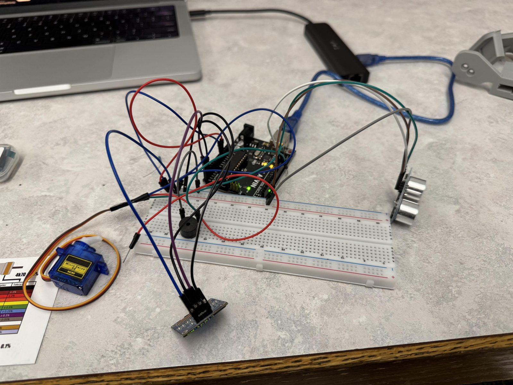
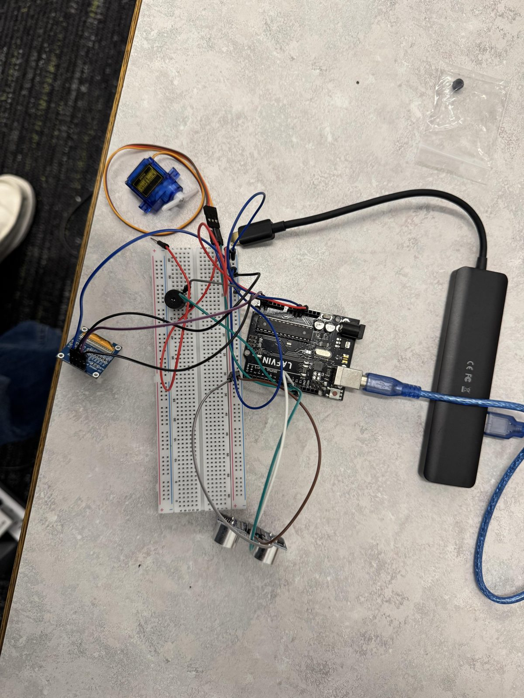
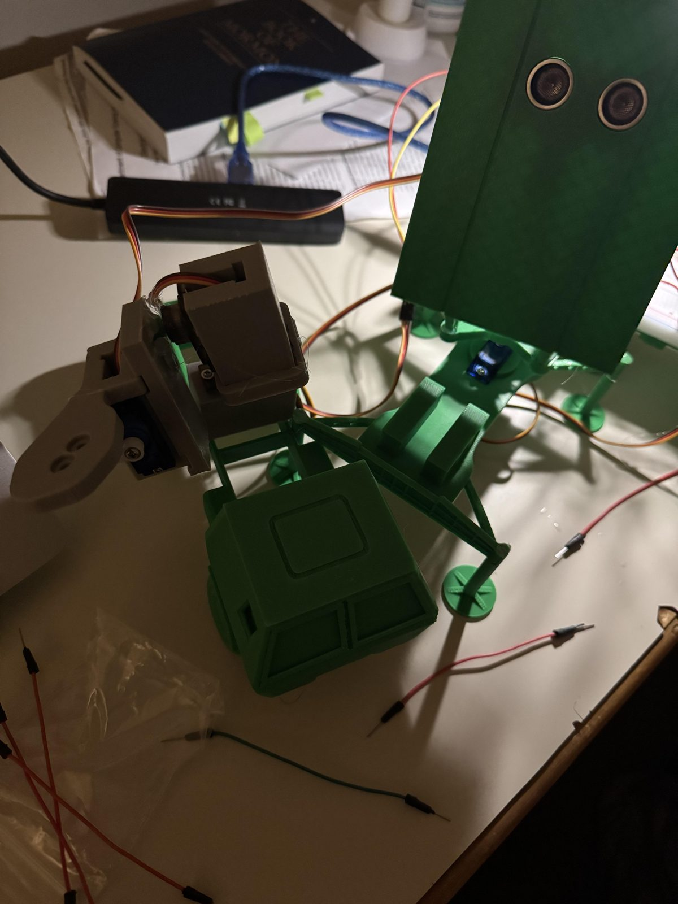

# Arduino Ultrasonic Detection System: Automatic Air Defense Turret

An Arduino Uno project that sweeps an ultrasonic distance sensor across a 150° arc, draws a **radar-style** live display on an OLED screen, gives audible proximity feedback with a piezo buzzer, and triggers a servo-driven launcher inside a 3D-printed turret when an object comes within a set range.

**Author:** Marcos Perez, Electrical Engineering, Brigham Young University–Idaho

| | |
|---|---|
| **Demo video** | [Watch on YouTube](https://www.youtube.com/watch?v=GHF34XWE1ww) |
| **Full project write-up (PDF)** | [docs/Marcos_Perez_Air_Defense_System_Project.pdf](docs/Marcos_Perez_Air_Defense_System_Project.pdf) |
| **Reference project** | [Automatic Missile Defence System (Instructables)](https://www.instructables.com/Automatic-Missile-Defence-System/) |

> **Note on terminology:** the HC-SR04 is an ultrasonic (sonar-type) distance sensor, not a radar sensor. "Radar" here describes the sweeping display style only.

---

## Engineering Objectives

- Build a sensing loop that sweeps an ultrasonic sensor with a servo and measures distance at each angle step.
- Visualize the readings in real time on an SSD1306 OLED as a rotating sweep line with a dot marking detected objects.
- Provide audio feedback with a piezo buzzer: a tick on every scan step and a rising-pitch alert as an object gets closer.
- Trigger a servo-driven launch action automatically when an object is inside a defined firing range.
- Integrate the display/audio system and the turret system into one program driven by a single shared sensor sweep.

## Photos


*Breadboard prototype: Arduino, ultrasonic sensor, OLED display, buzzer, and servo wiring.*


*Top-down view of the wired circuit, showing sensor and servo connections to the Arduino.*


*3D-printed turret housing with pan/tilt servo assembly and launcher body mounted.*

## Components

| Component | Role |
|---|---|
| Arduino Uno | Main microcontroller |
| HC-SR04 ultrasonic distance sensor | Distance measurement |
| 4× SG90 micro servos | Sensor sweep, turret pan/tilt aiming, and launch trigger (per the PDF write-up) |
| SSD1306 OLED display (I²C, U8g2 library) | Radar-style sweep display |
| Piezo buzzer | Scan ticks and proximity alert tones |
| Breadboard and jumper wires | Circuit prototyping |
| 3D-printed turret housing | Mounts the pan/tilt/trigger servos and launcher body |

## Technologies and Tools

Arduino (C/C++), Servo library, U8g2 library, I²C display interfacing, ultrasonic ranging, servo motor control, breadboard prototyping, SolidWorks / Fusion 360 and 3D printing (listed as tools used in the project write-up).

## How It Works

1. **Scanning:** A pan servo sweeps the ultrasonic sensor from 15° to 165° and back, measuring distance at each step.
2. **Radar-style display:** The OLED draws a sweep line synced to the servo angle, plus a dot at the detected object's position and distance.
3. **Audio feedback:** The buzzer ticks once per scan step and plays a rising-pitch alert as an object gets closer.
4. **Automatic firing:** When an object is detected within the defined firing range, the trigger servo fires the launch mechanism, then returns to its rest position before the scan continues.

In the integrated sketch, the firing range is set by a `FIRE_RANGE_CM = 30` constant.

## What Is My Work and What Is Referenced

| Part | Source |
|---|---|
| Radar display and buzzer sound system (OLED sweep, scan ticks, proximity alerts) | Original sketch written by me |
| Turret / firing mechanism and multi-servo turret logic | **Adapted from the [Automatic Missile Defence System](https://www.instructables.com/Automatic-Missile-Defence-System/) Instructables project**, used as a starting point and design reference |
| Combined sketch: one shared sensor sweep driving display, sound, and firing together | My integration of the two systems above |
| Breadboard circuit wiring and prototyping | Built by me |

The radar/OLED code and the turret code were first built and tested as two separate sketches, then merged. The turret mechanism is **not** an original design.

## Source Code

The `.ino` source files are not yet in this repository. See [`code/README.md`](code/README.md). The code excerpts shown in the project write-up are collected, clearly marked as excerpts, in [`docs/code-excerpts.md`](docs/code-excerpts.md). They are partial listings and are not complete, compilable programs.

## Status and Limitations

- The project write-up describes the radar/audio system and the turret as built and tested as separate sketches, and the combined sketch as a single working sketch. **No measurements, accuracy figures, or formal test results are documented**, so none are claimed here.
- Detection range, sweep timing, and firing behavior have not been characterized quantitatively.
- Ultrasonic sensors have a wide beam and are affected by surface angle and material. This is a general property of the sensor type, not a measured result from this project.

## Skills Demonstrated

- Embedded C/C++ on Arduino
- Interfacing sensors, servos, an I²C OLED display, and a buzzer
- Integrating two separate firmware programs into one real-time loop
- Breadboard circuit prototyping and wiring
- Adapting and extending an existing open design, with attribution
- Mechanical integration of a 3D-printed enclosure with electronics

## Repository Structure

```
.
├── README.md
├── code/        # Arduino sketches (see code/README.md)
├── docs/        # Project write-up PDF and code excerpts
└── images/      # Photos used in this README
```
